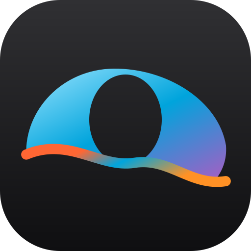

# Spice

A Jellyfin client for Android with iOS-style liquid glass, in the same minimal style as [Seekur](https://github.com/everettpenne/DuneDdit).
Sign in to your own Jellyfin server, browse your libraries, and play from them. Spice talks only to the server you give it.

- **Home:** Continue Watching, Next Up, and the latest in each library.
- **Library:** your libraries and favourites; sort by name, date added, year or rating.
- **Detail:** artwork, facts, Play/Resume, watched and favourite; seasons and episodes for a series.
- **Search:** movies, series, episodes, albums and artists, as you type.
- **Music:** your music libraries as artists and latest albums; an artist's albums; an album's tracks with numbers and durations. Play and
  Shuffle an album (or tap a track to play from it), with a now-playing screen and a mini-player above the tab bar while a song plays.
- **Player:** rotates. Held upright, the video sits at the top and the details sit below it: title, year, rating, runtime, seasons, the
  season's other episodes (tap one to switch) and More Like This. Turned sideways (or with the full-screen button) it fills the screen.
  It plays the original file when the phone can, and asks the server to transcode when it can't (including a file whose audio the phone
  cannot decode, such as DTS, which would otherwise play silently). Audio and subtitle choice, 10-second skips.
- **Background playback:** sound continues when you switch apps or lock the phone, with a media notification to pause or skip. Leaving the
  player (or swiping the app away) stops it. Progress is reported to the server from the playback service, so "Continue Watching" is right
  even after background listening.
- **Settings:** server and account, direct play or always transcode, play next episode, sign out.

Not yet: Quick Connect, live TV, downloads, casting, picture-in-picture, external subtitle files, a queue across several titles.

Spice is an independent app and is not affiliated with the Jellyfin project. It uses Jellyfin's public REST API.

## Privacy and security

- The only network traffic is to your Jellyfin server. There are no analytics and no third-party services.
- The access token is stored encrypted (Android Keystore, AES-GCM), is sent only in the `Authorization` header and only to your server's own host,
  and never appears in a URL. Backups are off.
- A server at `http://` (common on a home network) works, and the sign-in screen warns that it is not encrypted.

## Build

The liquid-glass UI kit (components, theme, type scale) is the separate `Glass` project, pulled in with a Gradle `includeBuild("../Glass")`, so it must be checked out next to this folder.

```bash
./gradlew :app:assembleDebug     # needs a JDK 21 and the Android SDK (compileSdk 36); minSdk 31
./gradlew :app:testDebugUnitTest # JVM tests with a mock server
```

Release signing comes from the environment (`SPICE_RELEASE_STORE_FILE`, `_STORE_PASSWORD`, `_KEY_ALIAS`, `_KEY_PASSWORD`); without all four the release build is left unsigned.

## Trying it without a server

`tools/fake-jellyfin/server.py` is a small stand-in server (needs Python with Pillow, and ffmpeg for its test video):

```bash
python3 tools/fake-jellyfin/server.py        # sign in as demo / demo; the emulator reaches it at 10.0.2.2:8096
```

`FlowAgainstFakeServerTest` and `PlayerBehaviourTest` (instrumented) drive connect → sign in → browse → detail → playback against it: leaving the player,
portrait and landscape layouts, a DTS file falling back to a transcode, and playback continuing in the background.

## Credits

Liquid glass by [Backdrop](https://github.com/Kyant0/AndroidLiquidGlass) (Apache-2.0); type is [Inter](https://github.com/rsms/inter) (SIL OFL 1.1, `docs/licenses/Inter-OFL.txt`) set to Apple's HIG scale;
playback by AndroidX Media3; images by Coil. MIT licensed, see `LICENSE`.

## Building with Glass

The shared UI kit lives in its own repository, [Glass](https://github.com/everettpenne/Glass), checked out next to this one (`../Glass`) and built
with it through `includeBuild`. `glass.version` names the Glass tag this app is built and released with; CI checks out exactly that tag. To
build locally, check Glass out beside this repository at that tag (`git -C ../Glass checkout $(cat glass.version)`).
